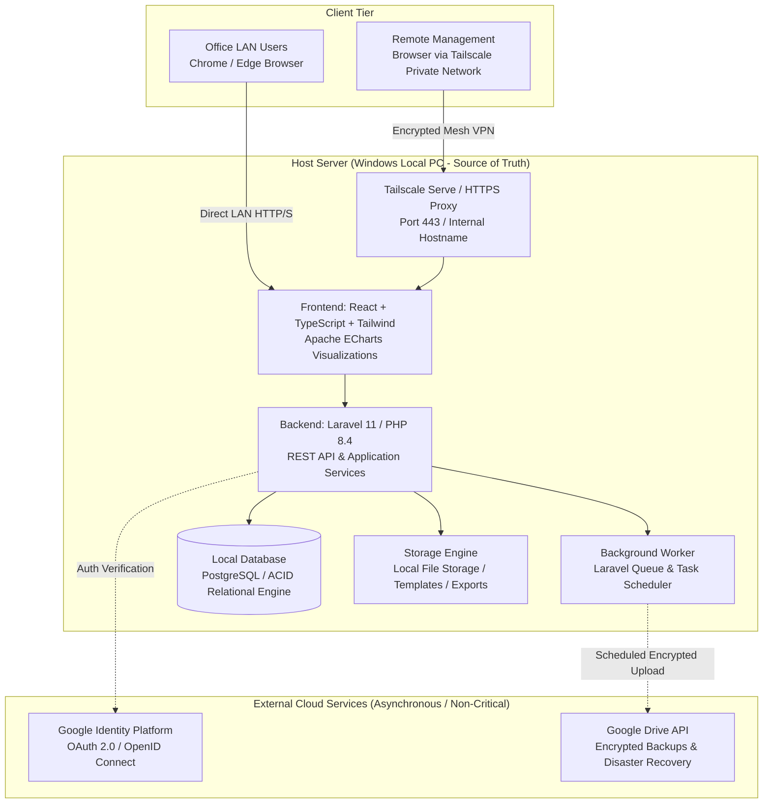
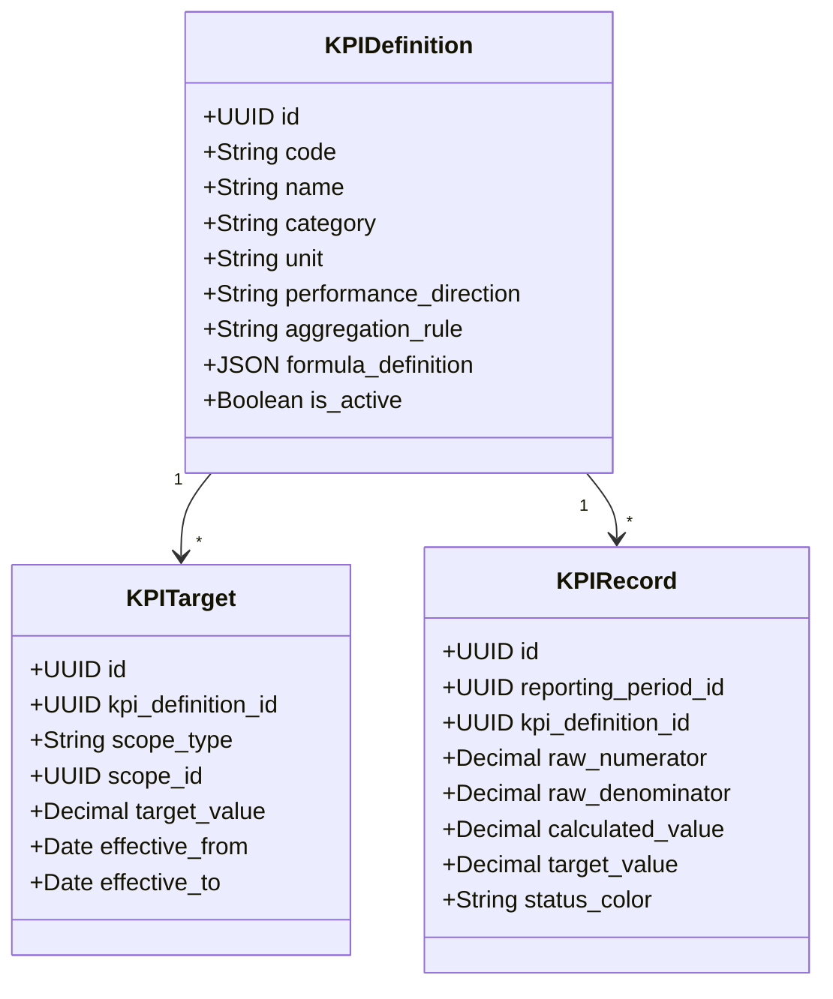
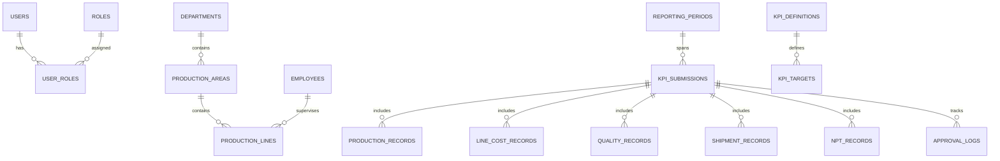
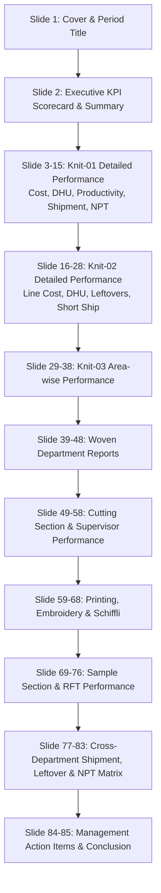
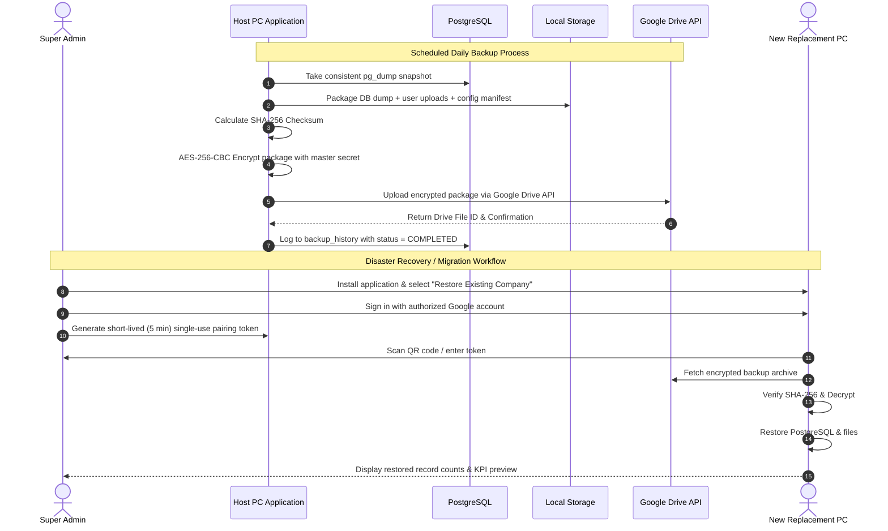

# UFL KPI Performance Management Software
## System Architecture, Data Dictionary, Database Design & Execution Plan
**Document Version:** 1.0  
**Date:** November 2026  
**Reference Specification:** UFL KPI Performance Management Software - Final Software Architecture & Developer Requirements (Version 1.0)  
**Reporting Baseline Reference:** *UFL KPI Performance Year to date-October 2026* (85-Slide Reference Presentation)

---

## 1. Executive Summary & Non-Negotiable Architecture Rules

The UFL KPI Performance Management Software is an on-premises, local-server-based enterprise application engineered for UFL factory operations. The software eliminates manual, error-prone compilation of monthly KPI reports by establishing an automated, single-source-of-truth system that collects daily/monthly departmental operational data, calculates standardized KPIs, presents live web dashboards over the office LAN, and generates fully editable PowerPoint presentations (matching the reference 85-slide deck), PDFs, and Excel reports.

### Architecture Boundaries & Principles

### Key Architectural Decisions (From Requirements)
1. **Source of Truth:** The host Windows PC's local database is the sole live database. It is **not** a cloud-hosted SaaS. If the host PC is powered down, remote access is paused until the PC is back online.
2. **Offline Resilience:** Office LAN users can enter data, view dashboards, and export reports even if the factory internet connection drops completely. External dependencies (Google OAuth, Google Drive backups, Tailscale) gracefully queue or show clear offline indicators without blocking core local factory operations.
3. **Editable Outputs (Zero Screenshots):** Generated PowerPoint reports must produce **native editable shapes, text boxes, and charts** using PptxGenJS / server-side document generators. Screenshots of dashboards are strictly prohibited.
4. **Data Integrity & Auditability:** Approved KPI submissions are locked. Corrections require an explicit revision workflow that records the modifier, change reason, and previous historical values. Historical formula changes do not silently mutate prior approved periods.
5. **Security & Zero Plaintext Secrets:** Google passwords are never requested or stored. OAuth refresh tokens are encrypted at rest. Backups uploaded to Google Drive are AES-256 encrypted before upload. Remote access does not expose database ports or utilize public router port-forwarding; it is secured via Tailscale private network mesh.

---

## 2. Departmental Scope & KPI Reporting Matrix

Based on the 85-slide reference presentation (*UFL KPI Performance Year to date-October 2026*), the system models 9 core production and specialized departments:

| Department / Section | Primary Scope & Reporting Categories | Granularity Level | Key Source Metrics |
| :--- | :--- | :--- | :--- |
| **Knit-01** | Line Cost Achievement, Average Sew DHU, Costing Productivity, Shipment Performance, Short Shipment, Leftover, Major NPT Reasons | Line-wise, Monthly, YTD | Planned/Actual Output, SMV, Earned Mins, Working Mins, Defects, Cost, Shipment Qty, Order Qty, Leftover Qty, NPT Hours & Reasons |
| **Knit-02** | Line Cost Achievement, Average Sew DHU, Costing Productivity, Shipment Performance, Short Shipment, Major NPT Reasons | Line-wise, Monthly, YTD | Planned/Actual Output, SMV, Earned Mins, Working Mins, Defects, Cost, Shipment Qty, Order Qty, Leftover Qty, NPT Hours & Reasons |
| **Knit-03** | Area-wise Performance, Shipment Performance, Leftover, Short Shipment, Major NPT Reasons | Area-wise, Monthly, YTD | Area Output, Plan vs Actual, Shipment Qty, Shortage, Leftover, NPT breakdown |
| **Woven** | Area-wise Performance, Shipment Performance, Leftover, Short Shipment, Major NPT Reasons | Area-wise, Line-wise, Monthly, YTD | Fabric consumption, Line performance, Shipment achievement, Leftover, NPT breakdown |
| **Cutting** | Overall Cutting KPI, Supervisor-wise KPI, Cutting Efficiency Achievement | Department & Supervisor | Marker efficiency, Planned vs Actual cut plies/units, Cutting DHU, Fabric utilization |
| **Printing** | Print Productivity KPI, Strike-off/Production DHU | Machine & Shift | Table/Machine output, Capacity utilization, Print DHU, Rejection rate |
| **Embroidery** | Embroidery Productivity KPI, Stitches Produced vs Target | Machine-wise | Stitches/hour, Head downtime, Thread breakage, Target vs Actual output |
| **Schiffli** | Schiffli Productivity KPI, Running hours vs Downtime | Machine-wise | Machine RPM, Yards embroidered, Breakdown hours, Shift output |
| **Sample** | Sample Section KPI, Supervisor-wise Sample KPI, Sample RFT (Right First Time) Performance | Supervisor & Buyer | Samples requested, Samples submitted, First-pass approval %, Revision count |

---

## 3. KPI Engine Data Dictionary & Calculation Rules

The KPI Engine is completely configurable via database records. No KPI names, formula algorithms, targets, line assignments, or reporting periods may be hardcoded.

### Approved Core KPI Formula Reference

### Formula Definitions & Calculation Rules

| KPI Code | KPI Name | Formula Algorithm | Target Direction | Unit | Aggregation & Zero-Denominator Safeguard |
| :--- | :--- | :--- | :--- | :--- | :--- |
| `PLAN_ACH` | Plan Achievement | $\frac{\text{Actual Output}}{\text{Planned Output}} \times 100$ | Higher is better | `%` | If Planned Output = 0, return `null` (or 0% if actual = 0). YTD is $\frac{\sum \text{Actual}}{\sum \text{Planned}} \times 100$ (Weighted, not average of percentages). |
| `EFF` | Sewing Efficiency | $\frac{\text{Standard Earned Minutes}}{\text{Available Working Minutes}} \times 100$ | Higher is better | `%` | Where Earned Mins = $\text{Actual Qty} \times \text{SMV}$. If Available Mins = 0, return `null`. YTD is weighted: $\frac{\sum \text{Earned Mins}}{\sum \text{Available Mins}} \times 100$. |
| `DHU` | Defects per Hundred Units | $\frac{\text{Total Defect Count}}{\text{Total Checked Units}} \times 100$ | Lower is better | `%` | If Checked Units = 0, return 0. Zero tolerance thresholds configurable. |
| `LINE_COST_ACH` | Line Cost Achievement | $\frac{\text{Budgeted / Target Line Cost}}{\text{Actual Line Cost}} \times 100$ | Higher is better | `%` | Tracks cost variance against allowable standard line running cost. |
| `COST_PROD` | Costing Productivity | $\frac{\text{Standard Allowed Minutes Value}}{\text{Total Production Cost}} \times 100$ | Higher is better | Ratio / % | Compares earned factory value to total line operator payroll and direct costs. |
| `ABS` | Absenteeism Rate | $\frac{\text{Absent Manpower}}{\text{Total Applicable Manpower}} \times 100$ | Lower is better | `%` | If Applicable Manpower = 0, return 0%. |
| `CUT_TO_SHIP` | Cut-to-Ship Ratio | $\frac{\text{Shipment Quantity}}{\text{Cutting Quantity}} \times 100$ | Higher is better | `%` | Target typically $\ge 98\%$. Measures fabric to final garment recovery. |
| `ORDER_TO_SHIP` | Order-to-Ship Ratio | $\frac{\text{Shipment Quantity}}{\text{Order Quantity}} \times 100$ | Higher is better | `%` | Measures overall commercial order fulfillment rate. |
| `SHORT_SHIP` | Short Shipment Qty | $\text{Order Quantity} - \text{Shipment Quantity}$ | Lower is better | Units | If Shipment $\ge$ Order, Short Shipment = 0. |
| `LEFTOVER` | Leftover Quantity | Finished goods remaining in warehouse post-shipment | Lower is better | Units | Direct recorded physical count. |
| `NPT_HOURS` | Non-Productive Time | $\sum \text{Recorded Lost Hours}$ | Lower is better | Hours | Categorized by: Machine Breakdown, Fabric Delay, Approvals, Absenteeism, Training, Print/Emb Delay, Machine Adjustment. |
| `SAMPLE_RFT` | Sample Right-First-Time | $\frac{\text{Samples Approved on 1st Submission}}{\text{Total Samples Submitted}} \times 100$ | Higher is better | `%` | Evaluated supervisor-wise and buyer-wise. |

> [!IMPORTANT]
> **Zero Denominators & Weighted Aggregation:**  
> 1. Arithmetic division by zero must never cause uncaught exceptions or default to zero unless explicitly approved in the data dictionary.
> 2. Monthly and Year-to-Date (YTD) figures **must never** average percentages directly ($\text{avg}(P_1, P_2, \dots)$). YTD efficiency, DHU, and Plan Achievement are strictly calculated from the sum of numerators divided by the sum of denominators.

---

## 4. Normalized Database Schema Design

The relational database comprises 22 core tables ensuring 3rd normal form (3NF), complete referential integrity, and automated audit logging.

### Table Specifications

#### 1. Identity & Access Management
*   `users`: `id` (UUID, PK), `google_sub` (unique), `email` (unique), `name`, `avatar_url`, `is_active` (bool), `last_login_at`, `created_at`, `updated_at`.
*   `roles`: `id` (PK), `slug` (unique: `super_admin`, `management`, `dept_head`, `pm`, `ie`, `quality_mgr`, `hr`, `shipment_team`, `supervisor`, `viewer`), `name`, `description`.
*   `permissions`: `id` (PK), `slug` (e.g., `kpi.submit`, `kpi.approve`, `backup.manage`, `report.export`).
*   `user_roles`: `user_id` (FK), `role_id` (FK), `department_id` (FK nullable - for scoped permissions), `line_id` (FK nullable - for supervisor scoping).
*   `user_invitations`: `id` (UUID, PK), `email`, `role_id` (FK), `invited_by_user_id` (FK), `token_hash`, `expires_at`, `accepted_at`.

#### 2. Organization Structure
*   `departments`: `id` (UUID, PK), `code` (e.g. `KNIT-01`, `KNIT-02`, `WOVEN`, `CUTTING`), `name`, `sort_order`, `is_active`.
*   `production_areas`: `id` (UUID, PK), `department_id` (FK), `code`, `name`.
*   `production_lines`: `id` (UUID, PK), `production_area_id` (FK), `line_number`, `line_name`, `supervisor_employee_id` (FK nullable).
*   `employees`: `id` (UUID, PK), `employee_code` (unique), `full_name`, `designation`, `department_id` (FK), `is_active`.

#### 3. KPI Definitions & Master Rules
*   `kpi_definitions`: `id` (UUID, PK), `code` (unique), `name`, `category` (`production`, `quality`, `cost`, `shipment`, `npt`, `hr`), `unit`, `precision_decimals`, `performance_direction` (`higher_is_better`, `lower_is_better`, `exact`), `aggregation_type` (`weighted_sum`, `sum`, `last`), `formula_expression`, `is_active`.
*   `kpi_targets`: `id` (UUID, PK), `kpi_definition_id` (FK), `scope_type` (`company`, `department`, `line`, `supervisor`), `scope_id` (UUID nullable), `target_value` (DECIMAL(19,4)), `warning_threshold` (DECIMAL(19,4)), `effective_from` (DATE), `effective_to` (DATE nullable).
*   `reporting_periods`: `id` (UUID, PK), `period_type` (`daily`, `monthly`), `year` (INT), `month` (INT), `start_date` (DATE), `end_date` (DATE), `is_closed` (BOOLEAN).

#### 4. Submissions & Approval Workflow
*   `kpi_submissions`: `id` (UUID, PK), `reporting_period_id` (FK), `department_id` (FK), `submitted_by_user_id` (FK), `status` (`draft`, `submitted`, `approved`, `rejected`, `revision_required`), `submission_notes`, `approved_by_user_id` (FK nullable), `approved_at` (TIMESTAMP nullable), `version` (INT default 1).
*   `approvals`: `id` (UUID, PK), `kpi_submission_id` (FK), `action` (`submit`, `approve`, `reject`, `request_revision`), `user_id` (FK), `comments`, `created_at`.
*   `audit_logs`: `id` (UUID, PK), `user_id` (FK nullable), `action`, `entity_type`, `entity_id`, `old_values` (JSONB), `new_values` (JSONB), `ip_address`, `user_agent`, `created_at`.

#### 5. Operational Domain Records
*   `production_records`: `id` (UUID, PK), `submission_id` (FK), `line_id` (FK), `record_date` (DATE), `planned_output` (INT), `actual_output` (INT), `smv` (DECIMAL(8,2)), `earned_minutes` (DECIMAL(12,2)), `working_hours` (DECIMAL(6,2)), `operators_count` (INT), `helpers_count` (INT), `efficiency` (DECIMAL(6,2)).
*   `line_cost_records`: `id` (UUID, PK), `submission_id` (FK), `line_id` (FK), `budgeted_cost` (DECIMAL(14,2)), `actual_cost` (DECIMAL(14,2)), `variance` (DECIMAL(14,2)), `cost_achievement_pct` (DECIMAL(6,2)), `costing_productivity` (DECIMAL(8,4)).
*   `quality_records`: `id` (UUID, PK), `submission_id` (FK), `line_id` (FK), `checked_units` (INT), `defect_units` (INT), `total_defects` (INT), `dhu` (DECIMAL(6,2)), `rejection_units` (INT), `ftt_pct` (DECIMAL(6,2)).
*   `shipment_records`: `id` (UUID, PK), `submission_id` (FK), `buyer_name`, `order_no`, `style_no`, `order_qty` (INT), `cutting_qty` (INT), `shipment_qty` (INT), `short_shipment_qty` (INT), `cut_to_ship_pct` (DECIMAL(6,2)), `order_to_ship_pct` (DECIMAL(6,2)), `on_time` (BOOLEAN).
*   `leftover_records`: `id` (UUID, PK), `submission_id` (FK), `buyer_name`, `style_no`, `leftover_qty` (INT), `reason`, `warehouse_location`.
*   `npt_records`: `id` (UUID, PK), `submission_id` (FK), `line_id` (FK), `reason_category` (e.g. `Machine Breakdown`, `Fabric Delay`), `lost_hours` (DECIMAL(8,2)), `operator_hours_lost` (DECIMAL(10,2)), `root_cause_analysis`, `corrective_action`, `responsible_person`.
*   `hr_records`: `id` (UUID, PK), `submission_id` (FK), `department_id` (FK), `total_manpower` (INT), `present_manpower` (INT), `absent_manpower` (INT), `absenteeism_pct` (DECIMAL(6,2)), `migration_count` (INT), `overtime_hours` (DECIMAL(10,2)).
*   `specialized_records`: `id` (UUID, PK), `submission_id` (FK), `department_type` (`cutting`, `printing`, `embroidery`, `schiffli`, `sample`), `supervisor_id` (FK nullable), `machine_id`, `metric_1_name`, `metric_1_value`, `metric_2_name`, `metric_2_value`, `downtime_hours`, `efficiency_pct`.

#### 6. Backups, Imports & Automated Exports
*   `import_batches`: `id` (UUID, PK), `department_id` (FK), `reporting_period_id` (FK), `uploaded_by_user_id` (FK), `original_filename`, `stored_filepath`, `rows_total`, `rows_successful`, `rows_failed`, `error_summary` (JSONB), `created_at`.
*   `generated_reports`: `id` (UUID, PK), `reporting_period_id` (FK), `report_type` (`full_company_pptx`, `dept_pptx`, `pdf_summary`, `excel_dump`), `scope_filter` (JSONB), `generated_by_user_id` (FK), `file_path`, `file_size_bytes`, `created_at`.
*   `backup_history`: `id` (UUID, PK), `backup_type` (`scheduled`, `manual`, `pre_migration`), `archive_filename`, `file_size_bytes`, `sha256_checksum`, `encrypted_status` (BOOLEAN), `google_drive_file_id`, `upload_status` (`pending`, `completed`, `failed`), `source_host_id`, `error_message`, `created_at`.
*   `backup_settings`: `id` (PK default 1), `auto_backup_enabled` (BOOL), `cron_schedule` (default `0 2 * * *`), `retention_daily` (INT default 7), `retention_weekly` (INT default 4), `retention_monthly` (INT default 12), `google_drive_folder_id`, `last_successful_backup_at`.

---

## 5. Automated Presentation Generator (85-Slide Architecture)

The reference report contains 85 slides. To replace manual preparation, the system features a **dynamic, template-driven PowerPoint generator** using PptxGenJS (running via Node service) or PhpSpreadsheet/PHPOffice.

### Slide Sequence Architecture

### Presentation Generator Capabilities
1. **Dynamic Slide Counts:** If a department adds or removes lines or supervisors, the presentation dynamically scales slides; it never cuts off lines or generates empty placeholder slides.
2. **True Native PPTX Elements:**
   * Text blocks use corporate Calibri/Arial typography with hierarchical heading weights.
   * Tables are native PPTX tables with alternating row shading, conditional color formatting (Green $\ge 100\%$, Amber $90-99\%$, Red $<90\%$), and formatted decimal strings.
   * Charts are native PowerPoint Bar/Column/Line charts containing actual data series, allowing managers to click, edit data labels, and format series inside Microsoft PowerPoint.
3. **Filtering Options:** Users can export:
   * Full Company Presentation (Complete 85-slide deck).
   * Single Department Deck (e.g. Cutting or Knit-01 only).
   * Monthly vs. YTD Comparison Deck.
   * Executive Management Summary Deck (10 slides).

---

## 6. Google Drive Backup, Disaster Recovery & QR Migration

### QR Security Rules
* QR codes contain **strictly a short-lived (5-minute expiration), single-use cryptographic pairing token**.
* QR codes **never contain** passwords, database credentials, encryption master keys, or OAuth refresh tokens.
* Tokens are invalidated immediately after consumption or upon expiration.

---

## 7. Role-Based Access Control (RBAC) & Scope Matrix

| Role Slug | Scope & Data Visibility | Data Entry & Excel Import | Submit Period | Approve & Finalize | System Config & Backups |
| :--- | :--- | :---: | :---: | :---: | :---: |
| **Super Admin** | Full Company | Yes | Yes | Yes | Full Access (Backups, Users, QR) |
| **Management** | Full Company | View Only | No | **Yes (Final Sign-off)** | View Logs, System Health |
| **Department Head** | Assigned Department | Yes | **Yes (Submit Dept)** | No | Manage Dept Lines / Supervisors |
| **Production Manager** | Production Departments | Yes | Yes | Review Only | View Production KPIs |
| **IE (Industrial Eng)** | Production & Specialized | Yes (SMV, Earned Mins) | No | Review Only | Manage Formulas & Line Targets |
| **Quality Manager** | Quality & DHU Records | Yes (DHU, Defects) | Yes (Quality) | Review Only | View Quality Trends |
| **HR** | Manpower & Attendance | Yes (Manpower, Absenteeism) | Yes (HR) | Review Only | View Attendance Metrics |
| **Shipment Team** | Shipment, Order, Leftover | Yes (Shipment Qty, Leftover) | Yes (Shipment) | Review Only | View Shipment KPIs |
| **Supervisor** | Assigned Production Line(s) | Yes (Daily Output, DHU, NPT) | No | No | View Assigned Line Data |
| **Viewer** | Assigned Reports / Dashboards | View Only | No | No | None |

---

## 8. Technical Stack & Execution Architecture

*   **Frontend:** React 18+ with TypeScript, Tailwind CSS, Lucide Icons, Headless UI / Radix primitives.
*   **Data Visualization:** Apache ECharts (for smooth interactive gauges, multi-axis YTD combo charts, drill-down heatmaps).
*   **Backend:** Laravel 11 / PHP 8.4 REST API & Service Architecture.
*   **Database:** PostgreSQL 16 (ACID, JSONB for dynamic definitions and audit logs, generated columns for high-speed indexing).
*   **Excel Processing:** PhpSpreadsheet / Laravel Excel (with pre-import validation, duplicate detection, dry-run previews, and row-level error reporting).
*   **PowerPoint Engine:** PptxGenJS (Node-based server-side renderer for 100% editable slides, shapes, tables, and native chart series).
*   **Authentication:** Google OAuth 2.0 / OpenID Connect with server-side JWT / session validation and local invitation whitelist.
*   **Remote Connectivity:** Tailscale private network mesh with Tailscale Serve (HTTPS termination, zero public port exposure).
*   **Windows Deployment:** Windows Background Service (running PHP built-in server or Apache/Nginx + queue worker), managed via NSSM or native Windows service wrapper.

---

## 9. Decision Log (DECISION_LOG.md Initial Entries)

1. **Local Host PC as Single Source of Truth:** Cloud database hosting was evaluated and rejected per management requirements. Operational data remains exclusively on the Windows local host PC to ensure continuous factory floor entry over office Wi-Fi/LAN even during ISP outages.
2. **Drive for Backup, Not Live Sync:** Real-time multi-PC database sync over cloud was rejected to prevent split-brain conflicts and latency on the factory network. Google Drive is designated strictly for versioned, encrypted daily/monthly backups.
3. **Editable Native PPTX Elements:** Prohibited taking dashboard screenshots for the presentation export. Management requires fully editable PowerPoint slides (text, tables, charts) matching the 85-slide baseline deck.
4. **Weighted YTD Calculation Engine:** Strictly prohibited averaging monthly percentages. The calculation engine aggregates underlying numerators and denominators across periods before computing ratios.
5. **Separation of Authentication and Authorization:** Google sign-in handles identity authentication, but application access is strictly whitelist-controlled via explicit administrator invitations and role assignments.
